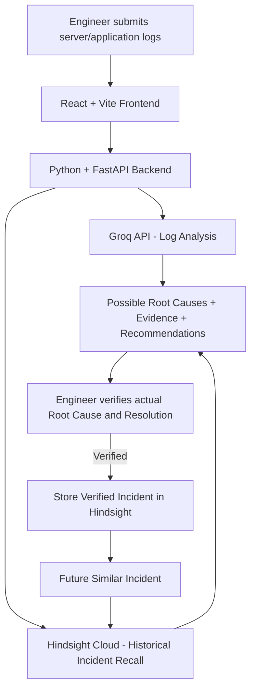

# AI-Powered Incident Response Agent

An AI-powered incident response system that analyses server and application logs, identifies possible root causes, retrieves similar historical incidents, and recommends investigation steps using AI and long-term memory.

<p align="center">
  <strong>Analyze Logs | Diagnose Causes | Recall Past Incidents | Investigate Faster</strong>
</p>

---

## Overview

When a server or application fails, engineers often spend valuable time examining logs, identifying the source of the problem, and searching for previous incidents.

The **AI Incident Response Agent** simplifies this investigation process by combining **Groq-powered log analysis** with **Hindsight long-term memory**.

The system analyses submitted logs, presents possible causes and supporting evidence, retrieves relevant historical incidents, and recommends investigation steps.

Its key capability is learning from previously verified incidents so that past solutions can assist engineers during future investigations.

## Key Features

- **AI-Powered Log Analysis:** Analyses server and application logs using the Groq API.
- **Root Cause Suggestions:** Identifies possible causes based on log evidence.
- **Historical Incident Retrieval:** Uses Hindsight to retrieve similar previously recorded incidents.
- **Investigation Recommendations:** Suggests practical checks for engineers.
- **Human Verification:** Allows engineers to confirm the actual root cause and resolution.
- **Verified Incident Memory:** Stores verified incidents for future reference.
- **Memory-Based Investigation:** Recalls relevant historical solutions when similar incidents occur again.

## Technology Stack

| Component | Technology |
|---|---|
| Frontend | React |
| Frontend Tooling | Vite |
| Backend | Python |
| API Framework | FastAPI |
| AI Model API | Groq |
| Long-Term Memory | Hindsight Cloud |
| Version Control | Git and GitHub |

## System Workflow

1. **Log Submission:** An engineer submits server or application logs through the frontend.
2. **AI Analysis:** The FastAPI backend processes the logs using Groq.
3. **Historical Retrieval:** Hindsight searches for similar historical incidents.
4. **Investigation Results:** The application displays possible root causes, log evidence, historical matches, and recommended checks.
5. **Engineer Verification:** The engineer confirms the actual root cause and resolution.
6. **Memory Retention:** Only verified incidents with confirmed resolutions are stored in Hindsight.
7. **Future Recall:** When similar logs are submitted again, the system can retrieve previously verified incidents to support investigation.

## Architecture



## Project Structure

```text
AI-Incident-Response-Agent/
│
├── backend/
│   ├── app/
│   ├── tests/
│   └── requirements.txt
│
├── frontend/
│   ├── src/
│   ├── public/
│   └── package.json
│
├── data/
│   └── sample_logs/
│
├── docs/
│
├── tests/
│
├── .gitignore
└── README.md
```

*This is a simplified overview. Refer to the repository for the complete project structure.*

## Getting Started

### Prerequisites

Make sure you have the following installed:

- Python 3.10 or a compatible version
- Node.js and npm
- Groq API key
- Hindsight Cloud credentials

### 1. Clone the Repository

```bash
git clone https://github.com/nadeem6456/AI-Incident-Response-Agent.git

cd AI-Incident-Response-Agent
```

### 2. Set Up the Backend

Navigate to the backend directory:

```bash
cd backend
```

Create a Python virtual environment:

```bash
python -m venv venv
```

Activate the virtual environment.

**Windows:**

```bash
venv\Scripts\activate
```

Install the required dependencies:

```bash
pip install -r requirements.txt
```

Configure your environment variables using the provided `.env.example` file.

Add the required Groq and Hindsight credentials using the exact variable names specified in the backend configuration.

Start the FastAPI server:

```bash
python -m uvicorn app.main:app --reload --port 8000
```

Backend URL:

`http://localhost:8000`

API documentation:

`http://localhost:8000/docs`

### 3. Set Up the Frontend

Open another terminal and navigate to the frontend directory:

```bash
cd frontend
```

Install dependencies:

```bash
npm install
```

Start the development server:

```bash
npm run dev
```

Open the local frontend URL displayed by Vite. Usually:

`http://localhost:5173`

## Example Use Case

Consider a payment service experiencing database connection timeouts.

The submitted logs indicate:

- High database connection pool usage.
- Connection acquisition timeouts.
- Failed database transactions.
- HTTP 503 responses.

The agent analyses these logs and identifies database connection pool exhaustion as a possible cause.

Hindsight retrieves similar historical incidents when available, helping the engineer investigate using previously recorded knowledge.

The engineer then investigates the issue, confirms the actual root cause, and records the verified resolution.

The verified incident becomes useful historical knowledge when a similar issue occurs again.

## Human-in-the-Loop Safety

The system is designed to assist engineers, not replace their judgment.

- AI-generated root causes are suggestions, not guaranteed diagnoses.
- Engineers are responsible for verifying the actual cause and resolution.
- Only verified incidents are retained as historical knowledge.
- The system recommends investigation steps but does not automatically execute server repairs.

## Demo Video

Watch the project demonstration:

[▶ Watch the AI Incident Response Agent Demo]([https://youtu.be/fuEvYDhZams](https://youtu.be/fuEvYDhzams?si=KuOjU7A3AYNx6_BN))

## Future Improvements

- Support additional log formats and monitoring sources.
- Improve historical incident matching.
- Add incident categorization and severity detection.
- Integrate with monitoring and alerting platforms.
- Improve investigation recommendations using accumulated verified incidents.

## Team

Built by a team of four engineering students.

| Team Member | GitHub Profile | Contribution |
|---|---|---|
| Karthik Raikar | [@Karthik-ctrl25](https://github.com/Karthik-ctrl25) | Hindsight integration and project integration |
| Kavya K | [@kavya-kalai](https://github.com/kavya-kalai) | Backend development |
| Chinmai Rampure | [@Chinmairampure28](https://github.com/Chinmairampure28) | Frontend development |
| Nadeem Nadaf | [@nadeem6456](https://github.com/nadeem6456) | Testing and QA |

## License

This project was developed as an educational engineering project.

Add an appropriate open-source license if you intend to distribute it under specific reuse terms.
